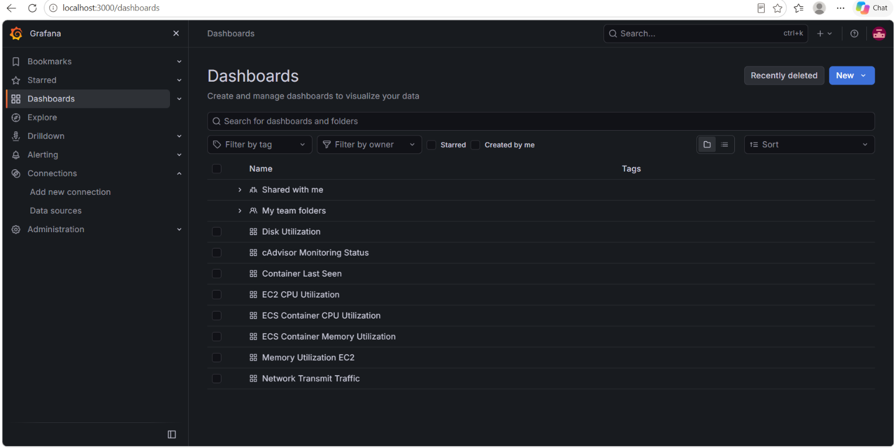
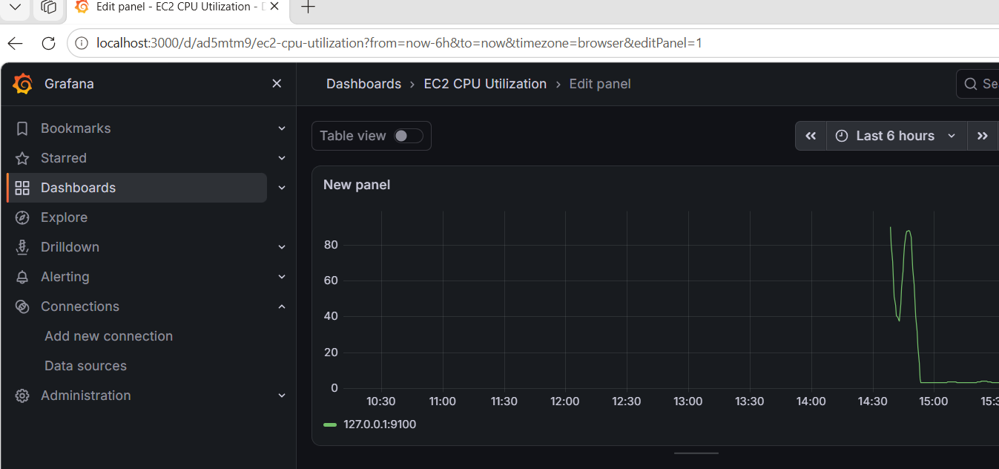
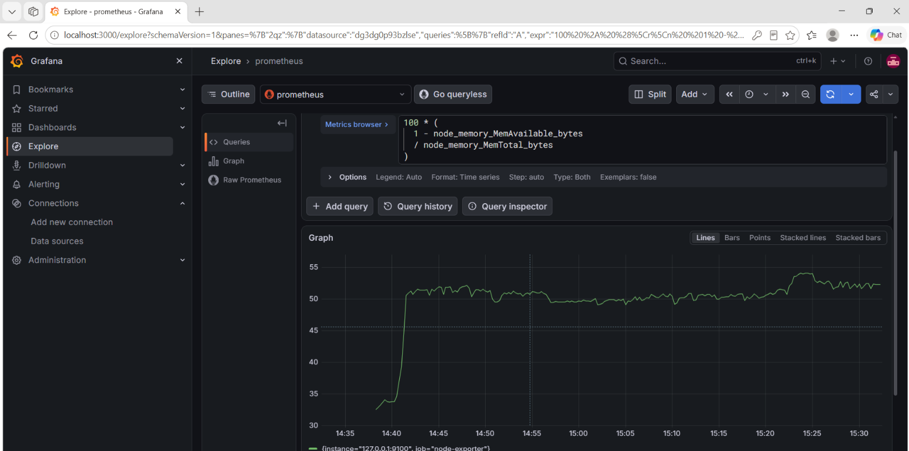
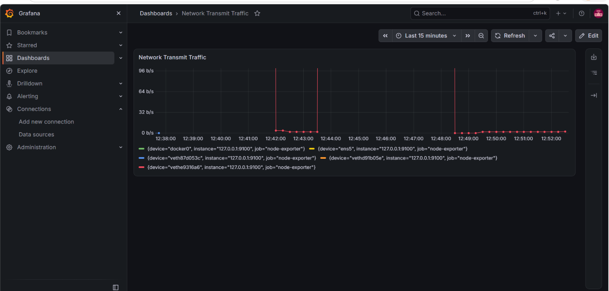

# ECS Application Infrastructure

This project provisions a small AWS learning environment in `ap-south-1`:

- A public VPC subnet, ECS cluster, one ECS-optimized EC2 container instance,
  a monitoring EC2 host, and a private ECR repository.
- Security groups that restrict SSH, Grafana, and Prometheus access to the
  IPv4 CIDR supplied as `my_ip`, and allow exporter/application metrics ports
  only from the monitoring host.
- A sample Flask application.

The monitoring host is provisioned without Prometheus or Grafana installed;
install and configure those services separately.

The Flask application exposes Prometheus metrics at `/metrics`, including
request totals by method, endpoint, and status code, request duration, and an
application-availability gauge. The metrics endpoint uses the same port 5000
as the application.
The ECS security group allows the monitoring host to reach port 5000, so
Prometheus can scrape `http://<ECS_PRIVATE_IP>:5000/metrics`. No additional
Terraform port mapping is needed for the metrics path.

## Grafana screenshots

The screenshots below document the local Grafana dashboards and Prometheus
query used while developing this project. They are illustrative; the Grafana
server shown in the browser is running locally and is not provisioned by this
Terraform configuration.

### Grafana dashboards



### EC2 CPU utilization



### Prometheus memory query



### Network transmit traffic



### Exported dashboards

The Grafana dashboard exports are in [`grafana/dashboards/`](grafana/dashboards/):

- `ec2-cpu.json`
- `ec2-memory.json`
- `ec2-disk.json`
- `network-transmit.json`
- `ecs-container-cpu.json`
- `ecs-container-memory.json`
- `container-last-seen.json`
- `cadvisor-monitoring-status.json`

Import a JSON file from Grafana using **Dashboards → New → Import**. Configure
the Prometheus data source and the relevant Node Exporter, cAdvisor, and ECS
metrics before expecting panels to return data. Grafana's per-instance
resource metadata and user identifiers have been removed from the exports.

## Repository contents

- `Terraform/`: reusable Terraform root configuration and resource modules.
- `application/`: Flask app, container definition, and frontend assets.
- `grafana/dashboards/`: exported Grafana dashboard JSON.
- `docs/screenshots/`: Grafana and Prometheus screenshots.
- `Terraform/.terraform.lock.hcl`: committed provider lock file for consistent
  Terraform provider selections.

## Prerequisites

- Terraform 1.6 or newer
- AWS CLI configured with credentials for the target account
- An AWS identity permitted to create the resources in the Terraform modules
- Docker, for building and publishing the sample application

## Configure and deploy

1. Change to `Terraform` and update `terraform.tfvars`. Replace the documentation
   IP with your public IPv4 address in `/32` notation. Choose instance types
   supported by your account and region; `t3.micro` is an example, not a
   guarantee of Free Tier eligibility or adequate capacity. Set `ssh_key_name`
   to an existing EC2 key pair if you need SSH access; it is `null` by default.
2. Initialize and review the plan:

   ```powershell
   terraform init
   terraform fmt -recursive
   terraform validate
   terraform plan
   ```

3. Apply the infrastructure with the service stopped initially, so the ECR
   repository can be created before the application image is pushed:

   ```powershell
   terraform apply -var="desired_count=0"
   ```

4. Build and push the application image. Use the `ecr_repository_url` output
   and your AWS account ID/region to authenticate Docker to ECR:

   ```powershell
   docker build -t ecs-monitoring-app ..\application
   aws ecr get-login-password --region ap-south-1 |
     docker login --username AWS --password-stdin <ACCOUNT_ID>.dkr.ecr.ap-south-1.amazonaws.com
   docker tag ecs-monitoring-app:latest <ECR_REPOSITORY_URL>:latest
   docker push <ECR_REPOSITORY_URL>:latest
   ```

5. Set `app_image_uri` in `terraform.tfvars` to the pushed image URI, then run
   `terraform plan` and `terraform apply` again. The configured desired count
   is one, as required for the running service.

## Outputs

Terraform outputs the ECR repository URL, ECS cluster name, ECS instance ID
and private IP, and monitoring host public/private IP addresses.

Port 5000 is temporarily exposed to `my_ip` for application testing; remove
that ingress rule when it is no longer needed. Ports 5000, 8080, and 9100 are
also allowed from the monitoring host security group. SSH, Grafana, and
Prometheus access is restricted to `my_ip`. Container CloudWatch logging is
not enabled.

## State and cleanup

Terraform state contains infrastructure metadata and may contain sensitive
values. It is generated locally and excluded from version control; do not
commit it. For shared or production use, configure a secured remote state
backend with locking and encryption.

Remember that AWS resources can incur charges. When finished, review the plan
and run `terraform destroy` from `Terraform`.
